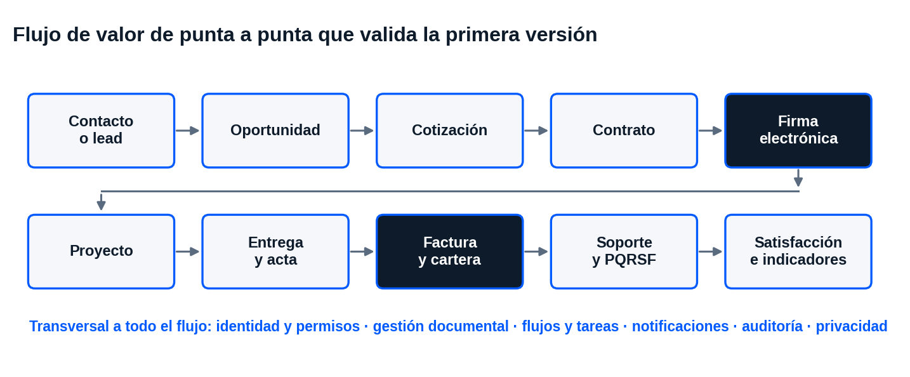

# 7. Visión del producto y mapa de módulos

## 7.1 Visión

ARZA ONE es la única fuente de verdad de la compañía. Un contacto que llega por el sitio web se convierte en oportunidad, cotización, contrato firmado electrónicamente, proyecto, entregas con acta, factura, cartera, soporte y medición de satisfacción, sin volver a digitar un dato y dejando en cada paso la evidencia que exige el Sistema de Gestión de la Calidad.

## 7.2 Principios rectores

| **Principio**                                     | **Qué significa en la práctica**                                                                                                                           |
|---------------------------------------------------|------------------------------------------------------------------------------------------------------------------------------------------------------------|
| **Seguridad desde el diseño**                     | Ninguna pantalla ni dirección de la API existe sin autenticación, permiso, validación de datos y auditoría. El navegador nunca es la barrera de seguridad. |
| **Privacidad desde el diseño y por defecto**      | Se pide el dato mínimo, se registra la finalidad y la autorización, los datos sensibles se cifran y solo los ve quien debe.                                |
| **Mínimo privilegio y segregación de funciones**  | Cada rol ve y hace lo necesario. Quien solicita no aprueba; quien administra el servidor no lee datos del negocio.                                         |
| **Una sola fuente de verdad**                     | Un cliente, un proveedor o un colaborador existe una sola vez. Los módulos se relacionan con ese registro, no lo copian.                                   |
| **Cero papel con valor probatorio**               | Los documentos nacen digitales, con versión, huella de integridad y firma electrónica cuando se requiere.                                                  |
| **Trazabilidad total**                            | Toda operación relevante responde: quién, qué, cuándo, sobre qué, con qué autorización y qué cambió.                                                       |
| **Procesos configurables, no programados**        | Los estados y aprobaciones se definen como datos en el motor de flujos; cambiar un flujo no exige reescribir código.                                       |
| **Sencillez operable**                            | Se elige la solución más simple que cumpla el requisito. Menos piezas significa menos fallas y menos costo.                                                |
| **Software libre y sin dependencia de proveedor** | Todas las bibliotecas son gratuitas y de código abierto con licencia permisiva; los datos pueden exportarse siempre.                                       |
| **Accesible y en español de Colombia**            | Interfaz clara, usable con teclado y lector de pantalla, fechas y moneda en formato colombiano.                                                            |

## 7.3 Usuarios de la plataforma

| **Actor**                         | **Qué necesita**                                                                   | **Por dónde entra**                 |
|-----------------------------------|------------------------------------------------------------------------------------|-------------------------------------|
| **Director General**              | Ver el estado de la empresa, aprobar, firmar y decidir                             | Aplicación interna                  |
| **Colaboradores de cada proceso** | Ejecutar su trabajo diario y sus tareas pendientes                                 | Aplicación interna                  |
| **Contador Público externo**      | Consultar operación financiera y descargar soportes                                | Aplicación interna, rol restringido |
| **Auditor interno o externo**     | Consultar evidencias sin modificar                                                 | Aplicación interna, solo lectura    |
| **Cliente**                       | Seguir sus proyectos, aprobar entregas, firmar, consultar facturas y pedir soporte | Portal de clientes                  |
| **Proveedor**                     | Enviar cotizaciones y documentos cuando se le invite                               | Enlace seguro de un solo uso        |
| **Visitante**                     | Conocer la empresa, pedir una cotización, radicar una PQRSF                        | Sitio público                       |
| **Titular de datos personales**   | Consultar, actualizar, rectificar o suprimir sus datos y revocar la autorización   | Sitio público y portal              |

## 7.4 Mapa de módulos y procesos del SGC que soporta

Los veintiún módulos se agrupan en cuatro familias. El núcleo transversal (M00 a M04 y M18, M19) sostiene a todos los demás y se construye primero.

| **Código** | **Módulo**                                               | **Familia** | **Proceso del SGC** | **Fase** |
|------------|----------------------------------------------------------|-------------|---------------------|----------|
| **M00**    | Núcleo: empresa, organización, catálogos y consecutivos  | Núcleo      | Todos               | F2       |
| **M01**    | Identidad y control de acceso                            | Núcleo      | TEC · DG            | F2       |
| **M02**    | Terceros: personas y organizaciones                      | Núcleo      | COM · ADM · GTH     | F2       |
| **M03**    | Gestión documental y control de documentos del SGC       | Núcleo      | SGC                 | F3       |
| **M04**    | Flujos, tareas y notificaciones                          | Núcleo      | Todos               | F2       |
| **M05**    | Comercial: CRM y cotizaciones                            | Misional    | COM                 | F4       |
| **M06**    | Contratos y firma electrónica                            | Misional    | COM · DG            | F4       |
| **M07**    | Proyectos y desarrollo de software                       | Misional    | TEC                 | F5       |
| **M08**    | Servicio al cliente: mesa de ayuda, PQRSF y satisfacción | Misional    | SAC                 | F5       |
| **M09**    | Portal del cliente                                       | Misional    | COM · SAC · TEC     | F5       |
| **M10**    | Facturación, cartera y finanzas operativas               | Apoyo       | FIN                 | F6       |
| **M11**    | Compras, proveedores y activos                           | Apoyo       | ADM                 | F6       |
| **M12**    | Talento humano                                           | Apoyo       | GTH                 | F7       |
| **M13**    | Seguridad y salud en el trabajo                          | Apoyo       | SST                 | F7       |
| **M14**    | Calidad y mejora continua                                | Estratégico | SGC                 | F7       |
| **M15**    | Innovación y propiedad intelectual                       | Estratégico | INN                 | F7       |
| **M16**    | Dirección: tableros, indicadores y requisitos legales    | Estratégico | DG                  | F9       |
| **M17**    | Sitio público, formularios y consentimiento de cookies   | Misional    | COM · DG            | F8       |
| **M18**    | Privacidad y cumplimiento                                | Núcleo      | DG                  | F2 y F8  |
| **M19**    | Auditoría y trazabilidad                                 | Núcleo      | SGC · TEC           | F2       |
| **M20**    | Asistente de inteligencia artificial                     | Estratégico | INN · TEC           | F9       |
