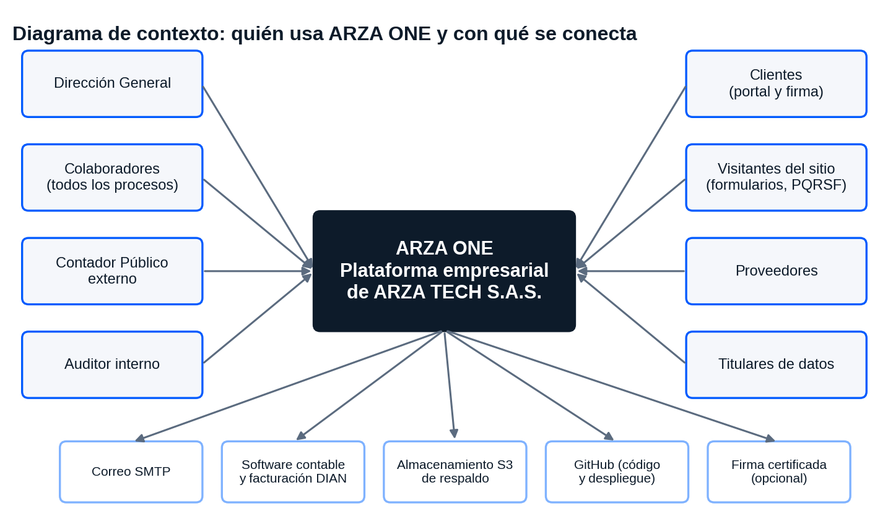
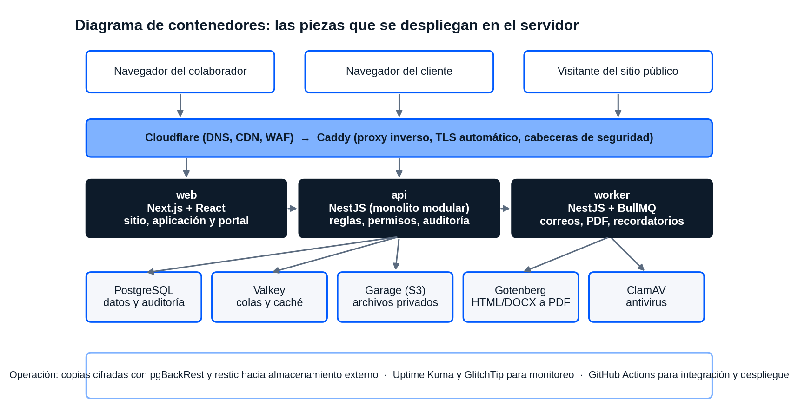
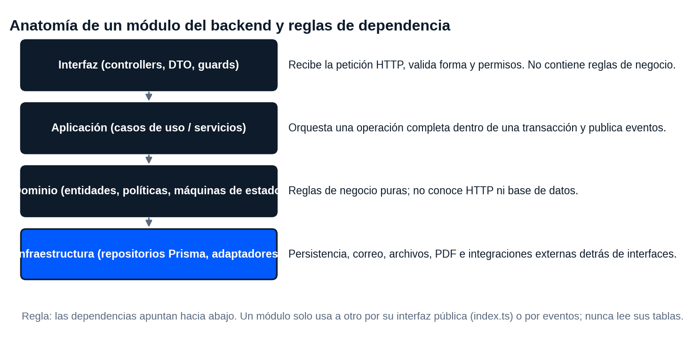

# 8. Arquitectura del sistema

## 8.1 Estilo de arquitectura

ARZA ONE es un monolito modular: una sola aplicación de servidor, dividida en módulos con fronteras que se verifican automáticamente. Se despliega como una unidad, usa una sola base de datos y, sin embargo, cada módulo puede entenderse, probarse y, si algún día hace falta, separarse. Es la arquitectura adecuada para un equipo pequeño: evita la complejidad de operar muchos servicios y conserva el orden interno.

## 8.2 Piezas que se despliegan

| **Pieza**      | **Tecnología**                 | **Responsabilidad**                                                                                                                           |
|----------------|--------------------------------|-----------------------------------------------------------------------------------------------------------------------------------------------|
| **web**        | Next.js y React                | Sitio público, aplicación interna y portal del cliente. Pide los datos a la API; no accede a la base de datos.                                |
| **api**        | NestJS                         | Todas las reglas del negocio, la autenticación, los permisos, la validación y la auditoría. Único componente que escribe en la base de datos. |
| **worker**     | NestJS con BullMQ              | Trabajos en segundo plano: correos, generación de PDF, recordatorios, vencimientos, análisis antivirus, copias.                               |
| **PostgreSQL** | PostgreSQL 17 o superior       | Datos transaccionales, auditoría, búsqueda de texto y seguridad por fila.                                                                     |
| **Valkey**     | Valkey (compatible con Redis)  | Colas de trabajos, límites de peticiones y caché de corta duración.                                                                           |
| **Garage**     | Almacenamiento con interfaz S3 | Archivos privados: documentos, adjuntos, evidencias de firma, exportaciones.                                                                  |
| **Gotenberg**  | Servicio de conversión         | Convierte plantillas HTML y documentos de oficina a PDF.                                                                                      |
| **ClamAV**     | Antivirus                      | Analiza cada archivo antes de aceptarlo.                                                                                                      |
| **Caddy**      | Proxy inverso                  | Recibe el tráfico, gestiona los certificados TLS y aplica cabeceras de seguridad.                                                             |

## 8.3 Estructura interna del backend

Cada módulo del capítulo 17 es una carpeta del backend con la misma anatomía. La regla de dependencias se comprueba en la integración continua con una herramienta de análisis: si un módulo importa el interior de otro, la verificación falla y el cambio no se integra.

- Los módulos de negocio dependen del núcleo (M00 a M04, M18 y M19); el núcleo no depende de ningún módulo de negocio.

- Dos módulos de negocio se comunican por eventos de dominio (por ejemplo, «contrato firmado») o por la interfaz pública del otro módulo, nunca leyendo sus tablas.

- Toda escritura ocurre dentro de una transacción que incluye el evento de auditoría y los eventos de dominio pendientes de publicar (patrón de bandeja de salida).

- Las integraciones externas (correo, software contable, firma certificada, inteligencia artificial) se implementan como adaptadores intercambiables detrás de una interfaz.

## 8.4 Decisiones de arquitectura (ADR)

Cada decisión se guarda en el repositorio como un archivo en docs/adr con la plantilla del anexo C. Cambiar una decisión exige un nuevo ADR que reemplace al anterior y la aprobación del Director General.

| **ADR** | **Decisión**                                                                                    | **Motivo principal**                                                            |
|---------|-------------------------------------------------------------------------------------------------|---------------------------------------------------------------------------------|
| **001** | Monolito modular con fronteras verificadas automáticamente                                      | Orden interno sin la complejidad de microservicios                              |
| **002** | TypeScript estricto en backend, frontend y contratos compartidos                                | Un solo lenguaje; errores detectados antes de ejecutar                          |
| **003** | Monorepo con pnpm y Turborepo                                                                   | Un repositorio, una versión, cambios atómicos                                   |
| **004** | NestJS para la API y el worker                                                                  | Módulos, inyección de dependencias y convenciones claras                        |
| **005** | Next.js con React para las tres superficies web                                                 | Renderizado en servidor para el sitio público y aplicación rica para lo interno |
| **006** | PostgreSQL como única base de datos, con Prisma para el acceso y las migraciones                | Transacciones, madurez, búsqueda y seguridad por fila en un solo motor          |
| **007** | Aislamiento multiempresa con columna tenant_id y seguridad por fila                             | La base de datos protege aunque el código falle                                 |
| **008** | Identidad propia: sesiones en cookie segura, Argon2id y MFA con TOTP                            | Sin dependencia externa; preparado para proveedor OIDC                          |
| **009** | Autorización RBAC más ABAC evaluada en el backend con CASL                                      | Permisos por rol y por contexto del registro                                    |
| **010** | Contratos de datos con Zod compartidos y OpenAPI generado                                       | El frontend y el backend no pueden desalinearse                                 |
| **011** | Motor de flujos definido por datos                                                              | Cambiar un proceso sin reprogramar                                              |
| **012** | Auditoría inmutable encadenada por hash en la misma transacción                                 | Evidencia confiable de cada operación                                           |
| **013** | Archivos en almacenamiento S3 privado con enlaces temporales                                    | Los documentos nunca quedan expuestos por dirección pública                     |
| **014** | Trabajos asíncronos con BullMQ sobre Valkey                                                     | Reintentos, programación y aislamiento de tareas lentas                         |
| **015** | Firma electrónica propia con paquete de evidencia; adaptador para firma certificada             | Cumple Ley 527 y Decreto 2364 sin costo por firma                               |
| **016** | Facturación fiscal, contabilidad y nómina por integración                                       | No reconstruir componentes regulados                                            |
| **017** | Despliegue con Docker Compose en un servidor por ambiente                                       | Reproducible y económico                                                        |
| **018** | GitHub y GitHub Actions para código, revisión y despliegue                                      | Gratuito para repositorios privados dentro de su cuota                          |
| **019** | Sistema de diseño con Tailwind CSS y componentes shadcn/ui sobre Radix                          | Accesibles, sin licencia y con el código dentro del repositorio                 |
| **020** | Fechas en UTC en la base de datos y zona America/Bogota en la interfaz; dinero en numeric(18,2) | Evita errores de hora y de redondeo                                             |
| **021** | Identificadores UUID versión 7 y consecutivos de negocio separados                              | Identificadores no adivinables y ordenables; códigos legibles para las personas |
| **022** | Inteligencia artificial solo mediante pasarela con control de permisos y registro               | La IA nunca salta la autorización ni recibe datos sin evaluación                |
