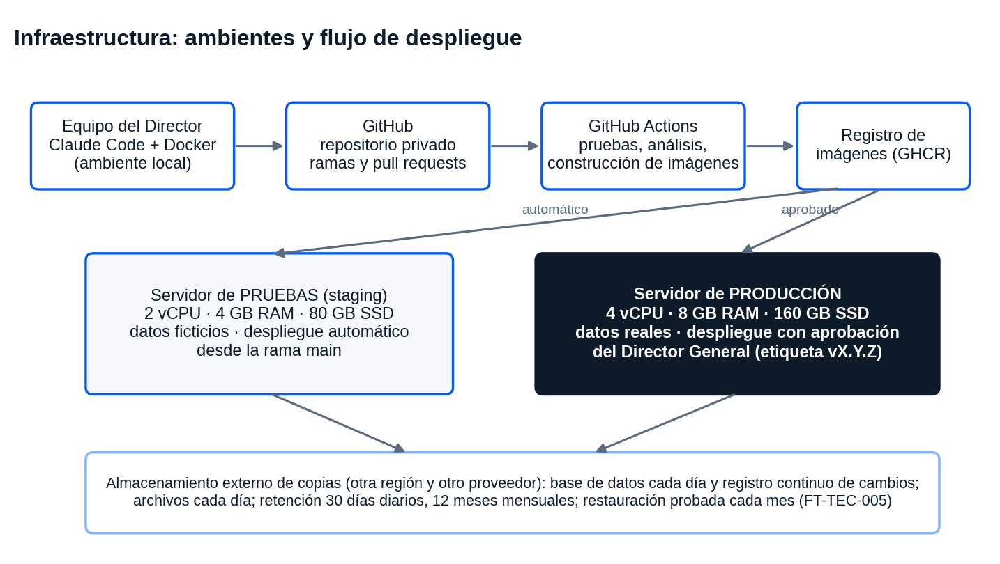

# 10. Servidor e infraestructura

## 10.1 Ambientes

| **Ambiente**          | **Dónde**                                       | **Datos**                                           | **Quién despliega**                                                          | **Para qué**                                                                 |
|-----------------------|-------------------------------------------------|-----------------------------------------------------|------------------------------------------------------------------------------|------------------------------------------------------------------------------|
| **Local**             | Equipo del Director General o del desarrollador | Ficticios, generados por guion                      | Un comando                                                                   | Construir y probar cada bloque con Claude Code                               |
| **Pruebas (staging)** | Servidor virtual pequeño                        | Ficticios; nunca copia de producción sin anonimizar | Automático al integrar a la rama principal                                   | Pruebas de aceptación, análisis de seguridad dinámico, ensayo de migraciones |
| **Producción**        | Servidor virtual principal                      | Reales                                              | Automático tras aprobación del Director General sobre una versión etiquetada | Uso real de colaboradores y clientes                                         |

## 10.2 Servidor de producción

| **Aspecto**                  | **Especificación**                                                                                                                                                                                                                |
|------------------------------|-----------------------------------------------------------------------------------------------------------------------------------------------------------------------------------------------------------------------------------|
| **Tipo**                     | Servidor virtual privado en un proveedor de nube reconocido, con centro de datos certificado ISO/IEC 27001 y acuerdo de tratamiento de datos                                                                                      |
| **Capacidad inicial**        | 4 núcleos virtuales, 8 GB de memoria, 160 GB de disco SSD, ancho de banda de 1 Gbps. Soporta holgadamente hasta 50 usuarios internos y 200 clientes                                                                               |
| **Cuándo ampliar**           | Uso sostenido de procesador o memoria superior al 70 % durante una semana, o disco por encima del 70 %. Primer paso: 8 núcleos y 16 GB. Segundo paso: separar la base de datos en un servidor propio                              |
| **Sistema operativo**        | Ubuntu Server LTS vigente, instalación mínima, actualizaciones de seguridad automáticas                                                                                                                                           |
| **Ubicación de los datos**   | Si el centro de datos está fuera de Colombia hay transmisión internacional de datos personales: se exige contrato de transmisión con el proveedor (Decreto 1074 de 2015, art. 2.2.2.25.5.2) y se declara en la política PL-DG-002 |
| **Acceso de administración** | Solo por SSH con llave, sin contraseña, sin usuario root, desde un usuario nominal con sudo; puerto protegido con fail2ban; segundo factor en la consola del proveedor                                                            |
| **Cortafuegos**              | Solo abiertos los puertos 80 y 443 (web) y el de SSH restringido. Ninguna base de datos ni servicio interno queda expuesto a internet                                                                                             |
| **Cifrado**                  | Disco cifrado si el proveedor lo ofrece; TLS 1.2 o superior en todo el tráfico; cifrado de copias con llave custodiada fuera del servidor                                                                                         |
| **Reloj**                    | Sincronización horaria por NTP; todos los registros en UTC                                                                                                                                                                        |

## 10.3 Servicios en el servidor

Todos los servicios se describen en un archivo de Docker Compose versionado en el repositorio (infra/compose). Cada servicio corre con un usuario sin privilegios, con límites de memoria, reinicio automático y verificación de salud.

| **Servicio**                | **Red**                                  | **Persistencia**                            | **Memoria** | **Verificación de salud**                     |
|-----------------------------|------------------------------------------|---------------------------------------------|-------------|-----------------------------------------------|
| **caddy**                   | Pública 80/443                           | Certificados                                | 128 MB      | Respuesta HTTP                                |
| **web**                     | Interna                                  | Ninguna                                     | 768 MB      | Ruta /healthz                                 |
| **api**                     | Interna                                  | Ninguna                                     | 1 GB        | Ruta /health (base de datos, colas, archivos) |
| **worker**                  | Interna                                  | Ninguna                                     | 768 MB      | Latido en la cola                             |
| **postgres**                | Interna                                  | Volumen de datos y archivo de cambios (WAL) | 2 GB        | pg_isready                                    |
| **valkey**                  | Interna                                  | Volumen con persistencia                    | 256 MB      | PING                                          |
| **garage**                  | Interna                                  | Volumen de archivos                         | 512 MB      | Ruta de salud                                 |
| **gotenberg**               | Interna                                  | Ninguna                                     | 768 MB      | Ruta de salud                                 |
| **clamav**                  | Interna                                  | Firmas de virus                             | 1,2 GB      | Respuesta del demonio                         |
| **backup**                  | Interna y salida                         | Repositorio externo                         | 256 MB      | Resultado de la última copia                  |
| **uptime-kuma y glitchtip** | Interna, acceso por subdominio protegido | Volumen propio                              | 512 MB      | Respuesta HTTP                                |

## 10.4 Dominios y direcciones

| **Dirección**                                      | **Contenido**                                                                   | **Público**                                         |
|----------------------------------------------------|---------------------------------------------------------------------------------|-----------------------------------------------------|
| **www.\[dominio\]**                                | Sitio público, formularios, textos legales, verificación de documentos firmados | Sí                                                  |
| **app.\[dominio\]**                                | Aplicación interna de colaboradores                                             | Requiere inicio de sesión y segundo factor          |
| **clientes.\[dominio\]**                           | Portal del cliente y firma de documentos                                        | Requiere inicio de sesión o enlace de firma         |
| **api.\[dominio\]**                                | Interfaz de programación                                                        | Requiere sesión o credencial de integración         |
| **pruebas.\[dominio\] y subdominios equivalentes** | Ambiente de pruebas                                                             | Protegido con autenticación adicional; no indexable |
| **estado.\[dominio\]**                             | Página de estado del servicio                                                   | Sí                                                  |
| **@\[dominio\]**                                   | Correo con registros SPF, DKIM y DMARC configurados                             | Evita la suplantación del remitente                 |

## 10.5 Copias de seguridad y recuperación

Se aplica la regla 3-2-1 del PL-TEC-001: tres copias, en dos medios distintos, una fuera del servidor y de otro proveedor. Las copias viajan y se guardan cifradas; la llave se custodia en el gestor de contraseñas corporativo y en sobre sellado en poder del Director General.

| **Qué se copia**             | **Cómo**                                                                             | **Frecuencia** | **Retención**                                                                        | **Recuperación** |
|------------------------------|--------------------------------------------------------------------------------------|----------------|--------------------------------------------------------------------------------------|------------------|
| **Base de datos**            | pgBackRest: copia completa semanal, diferencial diaria y archivo continuo de cambios | Continua       | 30 días con recuperación a cualquier minuto; mensual por 12 meses; anual por 10 años | RPO 15 minutos   |
| **Archivos (Garage)**        | restic incremental                                                                   | Diaria         | 30 diarias, 12 mensuales; los documentos se conservan según RE-SGC-005               | RPO 24 horas     |
| **Configuración y secretos** | Repositorio (configuración) y gestor de contraseñas (secretos)                       | En cada cambio | Historial completo                                                                   | Inmediata        |
| **Código**                   | GitHub y clon local                                                                  | En cada cambio | Historial completo                                                                   | Inmediata        |

| **Servicio**                   | **RTO**  | **RPO**    | **Estrategia**                                                           |
|--------------------------------|----------|------------|--------------------------------------------------------------------------|
| **Aplicación interna y API**   | 4 horas  | 15 minutos | Reconstruir el servidor desde el repositorio y restaurar la última copia |
| **Portal del cliente y firma** | 8 horas  | 15 minutos | Igual; se comunica por la página de estado                               |
| **Sitio público**              | 8 horas  | 24 horas   | Reconstruible por completo desde el repositorio                          |
| **Indicadores y tableros**     | 24 horas | 24 horas   | Se recalculan a partir de los datos                                      |

La restauración se ensaya el primer lunes de cada mes en el ambiente de pruebas y se registra en FT-TEC-005. Una copia que no se ha restaurado no cuenta como copia. El simulacro anual de pérdida total del servidor se registra en FT-TEC-006.

## 10.6 Despliegue y reversión

- Todo cambio llega a la rama principal por solicitud de integración (pull request) con las verificaciones automáticas en verde.

- Al integrar, GitHub Actions construye las imágenes, las analiza, las publica en el registro y despliega en pruebas. Allí se ejecutan las migraciones, las pruebas de humo y el análisis dinámico.

- Para publicar en producción el Director General crea una versión etiquetada (vX.Y.Z) y aprueba el despliegue en GitHub. El guion toma una copia de la base de datos, aplica las migraciones, actualiza los contenedores uno a uno y ejecuta las pruebas de humo.

- Si las pruebas de humo fallan, el guion vuelve automáticamente a la imagen anterior. Las migraciones se escriben siempre compatibles hacia atrás (expandir, migrar, contraer) para que la versión anterior funcione con la base ya migrada.

- Las ventanas de publicación son de martes a jueves antes de las 4:00 p. m.; nunca viernes ni víspera de festivo, salvo corrección urgente de seguridad.

- Cada publicación genera notas de versión y se registra como cambio en el módulo de calidad.

## 10.7 Monitoreo y alertas

| **Qué se vigila**                                     | **Umbral de alerta**                                                                                                   | **Canal**                                  | **Referencia**         |
|-------------------------------------------------------|------------------------------------------------------------------------------------------------------------------------|--------------------------------------------|------------------------|
| **Disponibilidad de sitio, aplicación, portal y API** | Dos fallas consecutivas en un minuto                                                                                   | Correo y mensajería al responsable técnico | PT-TEC-002, FT-TEC-003 |
| **Errores de aplicación**                             | Error nuevo o tasa superior al 1 % de las peticiones                                                                   | GlitchTip a correo                         | PT-TEC-002             |
| **Tiempo de respuesta de la API**                     | Percentil 95 superior a 800 ms durante 10 minutos                                                                      | Correo                                     | Capítulo 25            |
| **Procesador, memoria y disco**                       | 80 % sostenido 15 minutos; disco al 75 %                                                                               | Correo                                     | RE-TEC-002             |
| **Copias de seguridad**                               | Copia fallida o con más de 26 horas                                                                                    | Correo y mensajería                        | FT-TEC-005             |
| **Colas de trabajos**                                 | Más de 100 trabajos pendientes o fallidos sin reintento                                                                | Correo                                     | PT-TEC-002             |
| **Certificados y dominio**                            | 20 días antes del vencimiento                                                                                          | Correo                                     | PT-TEC-002             |
| **Seguridad**                                         | Cinco intentos fallidos de un mismo usuario, inicio de sesión de administrador, cambio de permisos, exportación masiva | Correo al Director General                 | PR-TEC-004             |
