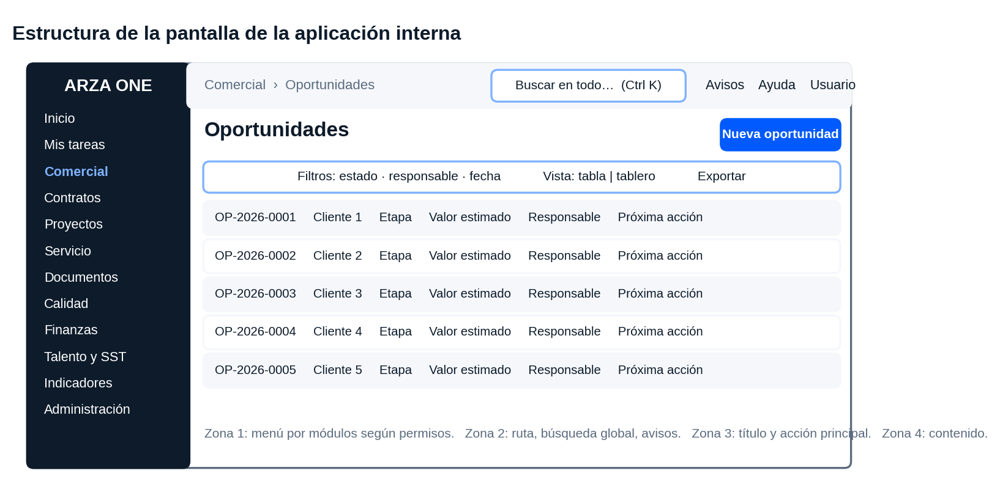

# 16. Diseño de la interfaz de usuario

## 16.1 Tres superficies, un solo sistema de diseño

| **Superficie**         | **Usuarios**           | **Carácter**                                                             | **Renderizado**                            |
|------------------------|------------------------|--------------------------------------------------------------------------|--------------------------------------------|
| **Sitio público**      | Visitantes y titulares | Institucional, rápido, indexable, con formularios y textos legales       | En servidor, páginas estáticas regeneradas |
| **Aplicación interna** | Colaboradores          | Herramienta de trabajo densa en información, navegación por módulos      | Aplicación de cliente tras autenticación   |
| **Portal del cliente** | Clientes               | Sencillo, orientado a tareas: ver avance, aprobar, firmar, pedir soporte | Aplicación de cliente tras autenticación   |

## 16.2 Sistema de diseño

Los valores se definen una sola vez como variables (tokens) en packages/ui y provienen del Manual de Identidad Corporativa MN-ADM-001. Ninguna pantalla usa un color, tamaño o espaciado que no sea un token.

| **Token**                 | **Valor**                                                           | **Uso**                                                                        |
|---------------------------|---------------------------------------------------------------------|--------------------------------------------------------------------------------|
| **Color primario**        | \#005AFE                                                            | Acción principal, enlaces, elemento activo                                     |
| **Color de marca oscuro** | \#0D1B2A                                                            | Menú lateral, encabezados, texto principal                                     |
| **Color de acento**       | \#7FB2FF                                                            | Resaltados, estados informativos, gráficas                                     |
| **Fondo**                 | \#F5F7FB y blanco                                                   | Fondo de la aplicación y de las tarjetas                                       |
| **Semánticos**            | Verde éxito, ámbar advertencia, rojo error, azul información        | Estados y validaciones; siempre acompañados de texto o icono, nunca solo color |
| **Tipografía de títulos** | Montserrat 600 y 700                                                | Títulos de página y de sección                                                 |
| **Tipografía de texto**   | Inter 400 y 500, base de 14 px en la aplicación y 16 px en el sitio | Contenido, formularios y tablas                                                |
| **Escala de espaciado**   | Múltiplos de 4 px                                                   | Márgenes y separaciones                                                        |
| **Radio y sombra**        | Radio de 8 px; sombra suave de un nivel                             | Tarjetas, campos y botones                                                     |
| **Modo oscuro**           | Juego de tokens alterno                                             | Opcional por usuario desde la primera versión del sistema de diseño            |
| **Contraste**             | Mínimo 4,5:1 en texto y 3:1 en componentes                          | Verificado automáticamente con axe-core                                        |

## 16.3 Estructura de la aplicación interna

- Menú lateral por módulos: muestra solo los módulos para los que el usuario tiene permiso; se contrae en pantallas pequeñas.

- Barra superior: ruta de navegación, búsqueda global con el atajo Ctrl K, avisos, ayuda contextual que enlaza el procedimiento del SGC correspondiente y menú del usuario.

- Inicio: tablero según el rol con «Mis tareas», vencimientos próximos, avisos y accesos frecuentes.

- Cada registro tiene una página de detalle con el mismo orden: encabezado con código, estado y acciones; pestañas de Resumen, Actividad, Documentos, Comentarios e Historial.

## 16.4 Patrones de pantalla

| **Patrón**                 | **Cuándo se usa**                                  | **Elementos obligatorios**                                                                                                                          |
|----------------------------|----------------------------------------------------|-----------------------------------------------------------------------------------------------------------------------------------------------------|
| **Listado**                | Consultar muchos registros                         | Búsqueda, filtros guardables, orden, paginación, selección de columnas, exportación auditada, acción principal, estado vacío con invitación a crear |
| **Tablero de tarjetas**    | Oportunidades, tareas de proyecto, tiquetes        | Columnas por estado, arrastrar para cambiar de estado con la misma validación del flujo, alternativa por teclado                                    |
| **Detalle**                | Ver un registro y actuar sobre él                  | Encabezado con estado, botones solo de las transiciones permitidas, línea de tiempo, relacionados                                                   |
| **Formulario**             | Crear o editar                                     | Etiquetas visibles, ayuda breve, validación al salir del campo y al enviar, resumen de errores, guardado de borrador, aviso al salir con cambios    |
| **Asistente por pasos**    | Procesos largos: cotización, contrato, vinculación | Pasos numerados, avance guardado, revisión final antes de confirmar                                                                                 |
| **Tablero de indicadores** | Dirección y líderes                                | Tarjetas de cifras con tendencia, gráficas con tabla de datos equivalente, acceso al detalle de origen                                              |
| **Visor de documento**     | Leer y aprobar                                     | Vista previa del PDF, metadatos, versión, botón de constancia de lectura, descarga según permiso                                                    |
| **Página de firma**        | Firmar un documento                                | Documento completo visible, datos del firmante, casilla de aceptación expresa, código de verificación, constancia descargable                       |

## 16.5 Estados que toda pantalla debe resolver

| **Estado**                        | **Comportamiento**                                                                                                   |
|-----------------------------------|----------------------------------------------------------------------------------------------------------------------|
| **Cargando**                      | Esqueleto del contenido; nunca pantalla en blanco ni bloqueo total                                                   |
| **Vacío**                         | Mensaje que explica qué se verá allí y botón para crear el primer registro                                           |
| **Error**                         | Mensaje claro en español, qué hacer, identificador de correlación para soporte y botón de reintento                  |
| **Sin permiso**                   | Explica que no tiene acceso y a quién solicitarlo; no revela datos                                                   |
| **Sin conexión o sesión vencida** | Conserva lo digitado y pide iniciar sesión de nuevo sin perder el trabajo                                            |
| **Éxito**                         | Confirmación breve y no intrusiva; la pantalla refleja el nuevo estado de inmediato                                  |
| **Acción irreversible**           | Diálogo de confirmación que nombra el registro y la consecuencia; exige escribir el código cuando el impacto es alto |

## 16.6 Accesibilidad, redacción y adaptación a dispositivos

- Nivel WCAG 2.2 AA: todo funciona con teclado, el foco es visible, los campos tienen etiqueta, los errores se anuncian al lector de pantalla y ningún contenido depende solo del color.

- Redacción: frases cortas en español de Colombia, trato de usted, verbos en infinitivo en los botones («Guardar», «Enviar a aprobación»), sin jerga técnica ni mensajes en inglés.

- Formatos: fechas dd/mm/aaaa, hora de 12 horas con a. m. y p. m., separador de miles con punto y decimales con coma, pesos con el símbolo \$.

- Adaptación: la aplicación interna se diseña para escritorio y funciona en tableta; el portal y el sitio público se diseñan primero para celular.

- Rendimiento: la primera pantalla útil en menos de 2,5 segundos en una conexión móvil promedio; las listas cargan por páginas.

- Privacidad en la interfaz: los datos restringidos aparecen enmascarados y se revelan con una acción deliberada que queda registrada.

## 16.7 Inventario de pantallas

| **Módulo**                   | **Pantallas principales**                                                                                                                                                                                                                                       |
|------------------------------|-----------------------------------------------------------------------------------------------------------------------------------------------------------------------------------------------------------------------------------------------------------------|
| **Acceso**                   | Inicio de sesión · Segundo factor · Activar cuenta · Recuperar contraseña · Mi perfil y seguridad · Sesiones activas                                                                                                                                            |
| **Inicio**                   | Tablero por rol · Mis tareas · Avisos · Búsqueda global                                                                                                                                                                                                         |
| **M00 · M01 Administración** | Empresa · Sedes · Procesos y cargos · Centros de costo · Catálogos · Parámetros · Consecutivos · Usuarios · Roles y permisos · Delegaciones · Flujos · Plantillas                                                                                               |
| **M02 Terceros**             | Listado · Ficha del tercero con línea de tiempo · Contactos · Conocimiento del tercero · Fusión de duplicados                                                                                                                                                   |
| **M03 Documental**           | Listado Maestro · Explorador de expedientes · Ficha y visor del documento · Nueva versión · Solicitud de Acción Documental · Aprobaciones · Constancias de lectura · Formatos digitales (diseñador y diligenciamiento) · Tabla de retención · Disposición final |
| **M05 Comercial**            | Leads · Embudo de oportunidades (tablero y tabla) · Ficha de oportunidad · Actividades · Portafolio y tarifas · Cotización (asistente y vista previa) · Informe del embudo                                                                                      |
| **M06 Contratos**            | Listado · Asistente de contrato desde plantilla · Ficha del contrato · Obligaciones · Otrosíes · Biblioteca de cláusulas · Envío a firma · Seguimiento de firmas · Página de firma · Verificación pública                                                       |
| **M07 Proyectos**            | Listado · Resumen del proyecto · Tablero de trabajo · Lista de pendientes · Iteraciones · Hitos y entregables · Acta de entrega · Registro de horas · Riesgos · Liberaciones · Revisiones de código · Incidentes                                                |
| **M08 Servicio**             | Bandeja de tiquetes · Ficha del tiquete · PQRSF (bandeja y ficha) · Encuestas y NPS · Base de conocimiento · Compensaciones · Garantías                                                                                                                         |
| **M09 Portal**               | Inicio del cliente · Mis proyectos · Entregables por aprobar · Contratos y firmas · Facturas · Soporte · Documentos · Usuarios de mi empresa · Mis datos y privacidad                                                                                           |
| **M10 Finanzas**             | Facturas · Registrar documento fiscal · Cartera por edades · Recaudos · Gestión de cobro · Presupuesto · Gastos · Caja menor · Conciliación bancaria · Exportación contable                                                                                     |
| **M11 Compras y activos**    | Solicitudes · Cuadro comparativo · Órdenes · Recepciones · Evaluación de proveedores · Viajes y legalizaciones · Activos · Asignaciones · Mantenimientos                                                                                                        |
| **M12 Talento humano**       | Colaboradores · Historia laboral · Vacantes · Candidatos (tablero) · Inducción · Permisos y vacaciones · Horas extras · Novedades de nómina · Desempeño · Formación · Disciplinarios · Retiro · Mi espacio (autoservicio)                                       |
| **M13 SST**                  | Matriz de peligros · Plan anual · Incidentes · Investigaciones · Inspecciones · Reportes de actos inseguros · Evaluaciones médicas · Entrega de elementos · Comités · Estándares mínimos                                                                        |
| **M14 Calidad**              | Mapa de procesos · Contexto y partes interesadas · Riesgos · No conformidades · Acciones · Programa y auditorías · Hallazgos · Indicadores · Revisión por la dirección · Lecciones aprendidas                                                                   |
| **M15 Innovación**           | Ideas · Hoja de ruta · Portafolio de propiedad intelectual · Vigilancia tecnológica · Competencia                                                                                                                                                               |
| **M16 Dirección**            | Tablero gerencial · Cuadro de mando · Normograma y evaluación de cumplimiento · Tablero de cumplimiento y segregación                                                                                                                                           |
| **M17 Sitio público**        | Inicio · Servicios · Nosotros · Contacto y cotización · PQRSF y consulta de radicado · Términos · Privacidad · Cookies y preferencias · Derechos del titular · Verificar documento                                                                              |
| **M18 Privacidad**           | Actividades de tratamiento · Avisos y versiones · Autorizaciones · Solicitudes de titulares · Incidentes · Encargados                                                                                                                                           |
| **M19 Auditoría**            | Consulta de eventos · Historial de un registro · Eventos de seguridad · Exportaciones · Verificación de integridad                                                                                                                                              |
