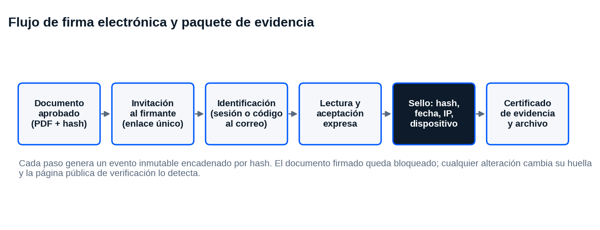

# 19. Firma electrónica

## 19.1 Fundamento

La Ley 527 de 1999 reconoce valor jurídico y probatorio a los mensajes de datos (arts. 5 y 10) y admite que el requisito de firma se cumpla con un método que identifique al firmante, indique su aprobación y sea confiable y apropiado para el propósito (art. 7). El Decreto 2364 de 2012 reglamenta la firma electrónica, exige que los datos de creación correspondan exclusivamente al firmante y que sea posible detectar cualquier alteración posterior, y permite a las partes acordar el mecanismo. La firma digital emitida por una entidad de certificación acreditada tiene además presunción legal de autenticidad (art. 28 de la Ley 527).

ARZA ONE implementa una firma electrónica propia, sin costo por firma, respaldada por un paquete de evidencia. Para los actos de mayor cuantía o riesgo, o cuando la contraparte lo exija, el mismo flujo puede enviarse a un proveedor de firma digital certificada mediante un adaptador.

| **Nivel**                           | **Mecanismo**                                                                                                                                                 | **Se usa para**                                                                                               |
|-------------------------------------|---------------------------------------------------------------------------------------------------------------------------------------------------------------|---------------------------------------------------------------------------------------------------------------|
| **1. Aceptación registrada**        | Usuario autenticado que marca una casilla y confirma; se registra versión, fecha, dirección IP y dispositivo                                                  | Términos de uso, políticas, constancias de lectura, aceptación de cotizaciones de bajo monto                  |
| **2. Firma electrónica con código** | Enlace único más código de un solo uso enviado al correo del firmante, o sesión con segundo factor; sello con huella del documento y certificado de evidencia | Contratos comerciales, órdenes de servicio, actas de entrega, contratos laborales, otrosíes, comodatos        |
| **3. Firma digital certificada**    | Certificado emitido por entidad de certificación acreditada por ONAC, mediante proveedor externo                                                              | Actos que la ley o la contraparte exijan con firma digital; títulos valores; cuantías que la Dirección defina |

## 19.2 Flujo

- El contrato aprobado se convierte a PDF definitivo y se calcula su huella SHA-256. Desde ese momento el archivo es inmutable.

- Se crea el proceso de firma con los firmantes, su orden y el plazo. Cada firmante recibe un enlace único e intransferible que vence.

- El firmante abre el enlace. Si no tiene sesión con segundo factor, recibe un código de seis dígitos en su correo registrado, válido por diez minutos y con máximo cinco intentos.

- La página muestra el documento completo, la identificación del firmante y la cláusula de aceptación del mecanismo de firma. El firmante marca la casilla «He leído y acepto el contenido de este documento y lo firmo electrónicamente» y confirma.

- El sistema registra el evento con fecha y hora del servidor, dirección IP, dispositivo, huella del documento y hash del evento anterior.

- Cuando firman todos, se genera el certificado de evidencia, se anexa al PDF, se archiva en el expediente y se envía copia a cada firmante.

## 19.3 Paquete de evidencia

| **Elemento**                          | **Contenido**                                                                                                                                                                                                                             |
|---------------------------------------|-------------------------------------------------------------------------------------------------------------------------------------------------------------------------------------------------------------------------------------------|
| **Documento firmado**                 | PDF original con una página final de firmas: nombre, identificación, fecha y hora, y código de verificación                                                                                                                               |
| **Certificado de evidencia**          | Identificador del proceso; huella SHA-256 del documento; por cada firmante: nombre, identificación, correo, método de autenticación, fecha y hora en UTC y en hora de Colombia, dirección IP, dispositivo y texto exacto de la aceptación |
| **Cadena de eventos**                 | Creación, envío, apertura, envío y validación del código, lectura, aceptación, rechazo, recordatorios y cierre, encadenados por hash                                                                                                      |
| **Sello de integridad de la empresa** | El PDF final se sella con un certificado de la empresa para que cualquier lector de PDF detecte alteraciones (fase F8)                                                                                                                    |
| **Verificación pública**              | Página www.\[dominio\]/verificar donde cualquiera ingresa el código o carga el archivo y confirma si coincide con el original, sin revelar su contenido                                                                                   |
| **Conservación**                      | Mínimo diez años o el plazo de la serie documental; copias de seguridad incluidas                                                                                                                                                         |

## 19.4 Condiciones para que la firma sea oponible

- Los contratos incluyen una cláusula en la que las partes aceptan la firma electrónica de ARZA ONE como mecanismo válido y confiable, y declaran que el correo registrado es de uso exclusivo del firmante.

- El correo y la identificación del firmante se verifican antes: en el conocimiento del tercero (FT-COM-003) para clientes y proveedores, y en la vinculación para colaboradores.

- Quien firma en nombre de una persona jurídica debe figurar como representante o apoderado en el certificado de existencia vigente cargado en el expediente.

- El firmante puede descargar el documento antes de firmar y recibe copia íntegra después.

- Los documentos que por ley exigen una formalidad distinta (escritura pública, autenticación notarial) no se firman por este mecanismo.

- El texto de la cláusula y el procedimiento se someten a validación del asesor jurídico antes de la salida a producción.
