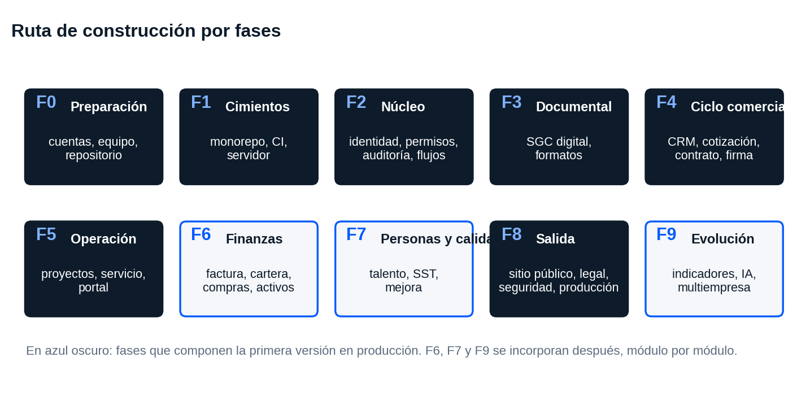

# 23. Plan de construcción con Claude Code

## 23.1 Cómo se va a construir

La plataforma se construye por fases y, dentro de cada fase, por bloques. Un bloque es una pieza pequeña y completa: tiene un objetivo, unos entregables y unos criterios de aceptación que se pueden comprobar. Claude Code escribe el código, las pruebas y la documentación de cada bloque; el Director General aprueba el plan antes de empezar, prueba el resultado en su navegador y decide si se acepta. No se construye por módulos completos de una vez ni se trabajan dos bloques a la vez: ese orden es lo que permite que un sistema grande se mantenga limpio.

## 23.2 Lo que debe saber antes de empezar

Este manual hace viable que una persona sin formación en programación dirija la construcción, pero no elimina tres realidades que conviene tener presentes desde el inicio.

| **Realidad**                          | **Qué implica**                                                                                                                                                                                                                                                                    | **Cómo se maneja**                                                                                                                  |
|---------------------------------------|------------------------------------------------------------------------------------------------------------------------------------------------------------------------------------------------------------------------------------------------------------------------------------|-------------------------------------------------------------------------------------------------------------------------------------|
| **Es un proyecto grande**             | La primera versión en producción (fases F0 a F5 y F8) representa entre 85 y 125 sesiones de trabajo supervisado. A un ritmo de cuatro o cinco sesiones por semana son de cinco a siete meses. Es una estimación: depende del ritmo, de los ajustes y del plan de Claude contratado | Construir por bloques, usar la plataforma internamente desde la fase F3 y no ampliar el alcance de la primera versión               |
| **El código generado debe revisarse** | Claude Code produce código de buena calidad y lo prueba, pero puede equivocarse. Las pruebas automáticas atrapan la mayoría de los errores; no todos                                                                                                                               | Verificaciones automáticas estrictas en cada cambio y revisión de un ingeniero externo en cuatro hitos (numeral 23.7)               |
| **Alguien debe operar el sistema**    | Un sistema en producción con datos de clientes exige atender alertas, copias y actualizaciones de seguridad                                                                                                                                                                        | Operación automatizada y documentada en guías; el Director General la asume con apoyo de Claude Code hasta proveer el cargo técnico |

## 23.3 Preparación (fase F0)

| **N.º** | **Actividad**                               | **Detalle**                                                                                                                                                                                                                                                                     |
|---------|---------------------------------------------|---------------------------------------------------------------------------------------------------------------------------------------------------------------------------------------------------------------------------------------------------------------------------------|
| **1**   | Equipo de trabajo                           | Portátil de desarrollo según PL-FIN-001: 32 GB de memoria, disco SSD de 1 TB, Windows 11 Pro, macOS o Linux                                                                                                                                                                     |
| **2**   | Gestor de contraseñas                       | Cuenta corporativa en Bitwarden. Todas las credenciales del proyecto se guardan allí, con segundo factor                                                                                                                                                                        |
| **3**   | Cuenta de GitHub                            | Organización «arza-tech» con el repositorio privado «arza-one»; segundo factor obligatorio                                                                                                                                                                                      |
| **4**   | Suscripción de Claude                       | Plan Pro, Max, Team o Enterprise; el plan gratuito no incluye Claude Code. Usar una cuenta a nombre de la empresa                                                                                                                                                               |
| **5**   | Dominio y correo                            | Dominio registrado y correo corporativo con SPF, DKIM y DMARC                                                                                                                                                                                                                   |
| **6**   | Proveedor de servidores                     | Cuenta con segundo factor; aún no se crea el servidor (se hace en el bloque B07)                                                                                                                                                                                                |
| **7**   | Programas en el equipo                      | En Windows: activar WSL 2 con Ubuntu e instalar Docker Desktop. En todos: Git, Node.js LTS, pnpm y Visual Studio Code                                                                                                                                                           |
| **8**   | Instalar Claude Code                        | En macOS, Linux o WSL: curl -fsSL https://claude.ai/install.sh \| bash. En Windows PowerShell: irm https://claude.ai/install.ps1 \| iex. Comprobar con claude --version y con claude doctor. También existe la aplicación de escritorio para quien prefiera no usar la terminal |
| **9**   | Crear el repositorio con el kit de arranque | Copiar al repositorio el archivo CLAUDE.md, la carpeta docs/manual con este manual en Markdown y la carpeta docs/bloques con los encargos. El kit se entrega junto con este manual                                                                                              |
| **10**  | Primera sesión                              | Abrir la terminal en la carpeta del repositorio, ejecutar claude, iniciar sesión y pedir el bloque B01 con el encargo del anexo B                                                                                                                                               |

## 23.4 Ciclo de trabajo de cada bloque

| **Paso**                   | **Quién**                                                                | **Qué ocurre**                                                                                                        | **Resultado**              |
|----------------------------|--------------------------------------------------------------------------|-----------------------------------------------------------------------------------------------------------------------|----------------------------|
| **1. Encargo**             | Director General                                                         | Entrega a Claude Code el encargo del bloque (plantilla del anexo B)                                                   | Bloque iniciado            |
| **2. Plan**                | Claude Code                                                              | Lee el manual y el código, y presenta qué va a crear, qué tablas, qué puntos de la API, qué pruebas y qué dudas tiene | Plan escrito               |
| **3. Aprobación del plan** | Director General                                                         | Resuelve las dudas. Si el plan se aparta del manual, se corrige o se registra una decisión de arquitectura            | Plan aprobado              |
| **4. Construcción**        | Claude Code                                                              | Programa en una rama propia, con pruebas, en commits pequeños                                                         | Código y pruebas           |
| **5. Verificación**        | Claude Code                                                              | Ejecuta todas las verificaciones y corrige hasta que pasen                                                            | Verificaciones en verde    |
| **6. Demostración**        | Director General                                                         | Sigue el paso a paso del cierre del bloque en su navegador y comprueba cada criterio de aceptación                    | Lista de criterios marcada |
| **7. Revisión**            | Claude Code en una sesión nueva; revisor externo si el bloque es crítico | Revisión del pull request contra el manual y la lista FT-TEC-002                                                      | Observaciones resueltas    |
| **8. Integración**         | Director General                                                         | Aprueba el pull request; se despliega solo en el ambiente de pruebas                                                  | Bloque en pruebas          |
| **9. Cierre**              | Claude Code y Director General                                           | Bitácora de cierre, documentación actualizada, pendientes anotados                                                    | Bloque terminado           |

**Reglas para trabajar bien con Claude Code**

- Una sesión nueva por bloque. El contexto de una conversación es limitado; lo permanente vive en CLAUDE.md, en el manual y en las bitácoras de cierre.

- Pida siempre primero el plan. Aprobar un plan toma minutos; rehacer código toma horas.

- No acepte un «ya quedó» sin evidencia: pida que le muestre el resultado de las verificaciones y pruebe usted mismo.

- Si algo falla, describa lo que vio (pantalla, mensaje, pasos) y pida la causa antes de la corrección.

- Nunca pegue contraseñas, llaves ni datos reales de clientes en la conversación.

- No pida «hazlo más rápido» quitando pruebas o controles. La instrucción del repositorio lo prohíbe y usted debe sostenerla.

- Cuando una decisión cambie lo que dice el manual, pida que se registre el ADR y actualice el capítulo.

- Guarde su trabajo: cada bloque termina integrado en GitHub. Lo que no está en GitHub no existe.

- La revisión del pull request hágala con una sesión distinta de la que escribió el código, para que revise con ojos nuevos.

## 23.5 Fases

| **Fase** | **Nombre**                | **Resultado**                                                                                                             | **Sesiones estimadas** |
|----------|---------------------------|---------------------------------------------------------------------------------------------------------------------------|------------------------|
| **F0**   | Preparación               | Dejar listas las cuentas, el equipo de trabajo y el repositorio. No se escribe código.                                    | 2 a 4                  |
| **F1**   | Cimientos                 | Repositorio ordenado, verificaciones automáticas, entorno local completo y servidor de pruebas con despliegue automático. | 8 a 12                 |
| **F2**   | Núcleo                    | Identidad, permisos, auditoría, datos maestros, archivos, flujos, notificaciones y base de privacidad.                    | 20 a 30                |
| **F3**   | Gestión documental        | Control de documentos del SGC, formatos digitales y carga de la documentación existente.                                  | 12 a 16                |
| **F4**   | Ciclo comercial           | CRM, cotizaciones, contratos y firma electrónica.                                                                         | 14 a 20                |
| **F5**   | Operación y servicio      | Proyectos, mesa de ayuda, PQRSF y portal del cliente.                                                                     | 16 a 24                |
| **F6**   | Finanzas y abastecimiento | Facturación, cartera, presupuesto, compras y activos.                                                                     | 12 a 18                |
| **F7**   | Personas, SST y calidad   | Talento humano, seguridad y salud en el trabajo, mejora continua e innovación.                                            | 18 a 26                |
| **F8**   | Salida a producción       | Sitio público, textos legales, cookies, privacidad completa, endurecimiento, servidor de producción y puesta en marcha.   | 14 a 20                |
| **F9**   | Evolución                 | Tableros gerenciales, asistente de inteligencia artificial y multiempresa.                                                | Por definir            |

Una sesión equivale a un espacio de dos a cuatro horas de trabajo supervisado. Las cifras son estimaciones para planear; el avance real se mide por bloques terminados.

## 23.6 Bloques

La columna «Crítico» señala los bloques que tocan seguridad, datos personales o validez legal y que requieren revisión externa. El encargo completo de cada bloque, con sus entregables y criterios, está en el kit (docs/bloques).

**F1 — Cimientos**

| **Bloque** | **Entrega**                                             | **Módulo**            | **Depende de**  | **Crítico** | **Criterios de aceptación**                                                                                                                                                                                                             |
|------------|---------------------------------------------------------|-----------------------|-----------------|-------------|-----------------------------------------------------------------------------------------------------------------------------------------------------------------------------------------------------------------------------------------|
| **B01**    | Monorepo y herramientas de calidad                      | Plataforma            | —               | —           | pnpm install, lint, typecheck, test y build terminan sin errores ni advertencias · Un commit con mensaje inválido o con un secreto de prueba es rechazado · Un import entre módulos que viole las fronteras hace fallar la verificación |
| **B02**    | Esqueleto de la API                                     | Plataforma            | B01             | —           | La API no arranca si falta una variable de entorno · Un error inesperado devuelve el formato del numeral 14.2 sin traza · /health informa el estado de base de datos, colas y archivos                                                  |
| **B03**    | Base de datos, contexto de empresa y seguridad por fila | M00 · Plataforma      | B02             | Sí          | Una consulta sin contexto de empresa no devuelve filas · La prueba de aislamiento con dos empresas pasa · Las migraciones aplican desde cero en una base vacía                                                                          |
| **B04**    | Esqueleto web y sistema de diseño                       | Plataforma · Interfaz | B01             | —           | La pantalla de ejemplo pasa accesibilidad sin violaciones · El menú se adapta a escritorio, tableta y celular · Ningún recurso se carga desde dominios de terceros                                                                      |
| **B05**    | Integración continua                                    | Plataforma            | B02 · B03 · B04 | —           | Un pull request con una prueba rota no puede integrarse · El tiempo total de las verificaciones es inferior a 15 minutos                                                                                                                |
| **B06**    | Entorno local completo                                  | Infraestructura       | B02 · B03       | —           | Un equipo nuevo levanta el proyecto siguiendo solo el README · El trabajo de ejemplo se ejecuta y se reintenta al fallar                                                                                                                |
| **B07**    | Servidor de pruebas y despliegue automático             | Infraestructura       | B05 · B06       | Sí          | Integrar a main publica la versión en pruebas sin intervención · Solo los puertos 80, 443 y SSH están abiertos · Una versión que falla las pruebas de humo se revierte sola                                                             |

**F2 — Núcleo**

| **Bloque** | **Entrega**                                                     | **Módulo**       | **Depende de** | **Crítico** | **Criterios de aceptación**                                                                                                                                                                                |
|------------|-----------------------------------------------------------------|------------------|----------------|-------------|------------------------------------------------------------------------------------------------------------------------------------------------------------------------------------------------------------|
| **B08**    | Identidad: cuentas, inicio de sesión y sesiones                 | M01              | B03 · B04      | Sí          | Las reglas del numeral 15.1 se cumplen y están probadas · El mensaje de error no revela si un correo existe · Cambiar la contraseña cierra todas las sesiones                                              |
| **B09**    | Segundo factor y seguridad de sesión                            | M01              | B08            | Sí          | Un usuario interno sin segundo factor no pasa de la pantalla de configuración · El secreto TOTP se guarda cifrado · Cerrar una sesión desde otro dispositivo surte efecto inmediato                        |
| **B10**    | Roles, permisos y autorización                                  | M01              | B08            | Sí          | Cada punto de la API declara su permiso; una prueba falla si alguno no lo hace · Nadie puede asignarse permisos a sí mismo · La interfaz oculta lo que el usuario no puede hacer y la API lo deniega igual |
| **B11**    | Auditoría y trazabilidad                                        | M19              | B10            | Sí          | Una prueba recorre todos los casos de uso de escritura y falla si alguno no audita · El usuario de la aplicación no puede modificar ni borrar eventos · Alterar una fila hace fallar la verificación       |
| **B12**    | Núcleo: organización, catálogos, consecutivos y parámetros      | M00              | B10 · B11      | —           | Los criterios de la ficha 17.1 · El cálculo de días hábiles acierta en veinte casos con festivos                                                                                                           |
| **B13**    | Terceros                                                        | M02              | B12            | —           | Los criterios de la ficha 17.3                                                                                                                                                                             |
| **B14**    | Archivos                                                        | M03 · Plataforma | B11            | Sí          | Un archivo de ensayo con firma de virus es rechazado · Un enlace de descarga vence a los cinco minutos · Un usuario sin permiso no obtiene el enlace                                                       |
| **B15**    | Motor de flujos y tareas                                        | M04              | B12            | —           | Los criterios de la ficha 17.5 · Una transición no definida es rechazada por la API                                                                                                                        |
| **B16**    | Notificaciones, correo, comentarios y adjuntos                  | M04              | B15 · B14      | —           | Un aviso fuera de jornada se entrega al inicio del siguiente día hábil · Ningún evento se pierde si el worker se reinicia                                                                                  |
| **B17**    | Privacidad: avisos, autorizaciones y actividades de tratamiento | M18              | B13            | Sí          | Ningún formulario con datos personales se envía sin autorización registrada · Cada autorización guarda la versión del aviso aceptado                                                                       |

**F3 — Gestión documental**

| **Bloque** | **Entrega**                                   | **Módulo** | **Depende de** | **Crítico** | **Criterios de aceptación**                                                                                                                      |
|------------|-----------------------------------------------|------------|----------------|-------------|--------------------------------------------------------------------------------------------------------------------------------------------------|
| **B18**    | Documentos, versiones y expedientes           | M03        | B14 · B15      | —           | Solo existe una versión vigente por documento · Un documento vigente no puede modificarse                                                        |
| **B19**    | Control documental del SGC y carga inicial    | M03        | B18            | —           | El Listado Maestro en línea coincide con RE-SGC-001 · Quien elabora no puede aprobar · Publicar una versión deja obsoleta la anterior y notifica |
| **B20**    | Formatos digitales y generación de documentos | M03        | B19            | —           | El PDF generado reproduce el encabezado y el pie de la plantilla institucional · Un registro conserva la versión del formato con que se creó     |
| **B21**    | Retención, disposición y búsqueda             | M03        | B19            | —           | Nada se elimina sin regla vencida y aprobación · La búsqueda nunca devuelve un documento que el usuario no puede abrir                           |

**F4 — Ciclo comercial**

| **Bloque** | **Entrega**                                 | **Módulo** | **Depende de**  | **Crítico** | **Criterios de aceptación**                                                                                                         |
|------------|---------------------------------------------|------------|-----------------|-------------|-------------------------------------------------------------------------------------------------------------------------------------|
| **B22**    | CRM: contactos, oportunidades y actividades | M05        | B13 · B15 · B17 | —           | Los criterios de la ficha 17.6 que aplican · El informe coincide con RE-COM-001                                                     |
| **B23**    | Portafolio y cotizaciones                   | M05        | B22 · B20       | —           | Los totales coinciden al centavo en diez casos de prueba · Una cotización enviada no se edita · No se acepta una cotización vencida |
| **B24**    | Contratos                                   | M06        | B23             | —           | Un contrato generado es idéntico al modelo salvo las variables · Una cláusula modificada exige aprobación de la Dirección           |
| **B25**    | Firma electrónica                           | M06        | B24 · B09       | Sí          | Los criterios de la ficha 17.7 · El recorrido completo de firma está automatizado · Modificar el PDF hace fallar la verificación    |

**F5 — Operación y servicio**

| **Bloque** | **Entrega**                                    | **Módulo** | **Depende de** | **Crítico** | **Criterios de aceptación**                                                                                          |
|------------|------------------------------------------------|------------|----------------|-------------|----------------------------------------------------------------------------------------------------------------------|
| **B26**    | Proyectos: estructura y tablero de trabajo     | M07        | B24 · B15      | —           | Un miembro solo ve sus proyectos · Un ítem no entra a una iteración sin criterios de aceptación                      |
| **B27**    | Proyectos: horas, entregables, actas y control | M07        | B26 · B25      | —           | Aceptar un entregable genera el acta firmada y el evento para facturar · El avance coincide con los ítems terminados |
| **B28**    | Mesa de ayuda                                  | M08        | B15 · B16      | —           | El reloj se pausa en espera del cliente · Un tiquete al 80 % del plazo genera alerta                                 |
| **B29**    | PQRSF, encuestas y base de conocimiento        | M08        | B28            | —           | Los criterios de la ficha 17.9 · El plazo se calcula en días hábiles                                                 |
| **B30**    | Portal del cliente                             | M09        | B27 · B29      | Sí          | Los criterios de la ficha 17.10 · Ningún punto de la API entrega datos de otra organización                          |

**F6 — Finanzas y abastecimiento**

| **Bloque** | **Entrega**                                            | **Módulo** | **Depende de** | **Crítico** | **Criterios de aceptación**                                                                |
|------------|--------------------------------------------------------|------------|----------------|-------------|--------------------------------------------------------------------------------------------|
| **B31**    | Facturación, cartera y recaudo                         | M10        | B27            | —           | Los criterios de la ficha 17.11 que aplican · Una factura emitida solo se corrige con nota |
| **B32**    | Presupuesto, gastos, caja menor y exportación contable | M10        | B31            | —           | Lo exportado coincide con lo registrado · Un periodo cerrado no admite cambios             |
| **B33**    | Compras, proveedores y viajes                          | M11        | B13 · B15      | —           | Los criterios de la ficha 17.12                                                            |
| **B34**    | Activos                                                | M11        | B33 · B25      | —           | El libro coincide con RE-ADM-003 · Todo activo asignado tiene comodato firmado             |

**F7 — Personas, SST y calidad**

| **Bloque** | **Entrega**                                                  | **Módulo** | **Depende de** | **Crítico** | **Criterios de aceptación**                                                                                                                 |
|------------|--------------------------------------------------------------|------------|----------------|-------------|---------------------------------------------------------------------------------------------------------------------------------------------|
| **B35**    | Talento humano: colaboradores, selección y vinculación       | M12        | B25 · B17      | Sí          | Vincular crea cuenta, inducción, evaluación médica y asignación de equipo · Los datos de candidatos descartados tienen fecha de eliminación |
| **B36**    | Talento humano: novedades, desempeño y retiro                | M12        | B35            | —           | Los criterios de la ficha 17.13 · El retiro revoca accesos y lista activos por devolver                                                     |
| **B37**    | Seguridad y salud en el trabajo                              | M13        | B36            | —           | Los criterios de la ficha 17.14                                                                                                             |
| **B38**    | Calidad: procesos, riesgos, no conformidades y acciones      | M14        | B15            | —           | Una queja procedente crea la no conformidad enlazada · La bitácora coincide con RE-SGC-002                                                  |
| **B39**    | Calidad: auditorías, indicadores y revisión por la dirección | M14        | B38            | —           | Un auditor no puede auditar su proceso · La matriz coincide con RE-SGC-006                                                                  |
| **B40**    | Innovación y propiedad intelectual                           | M15        | B15            | —           | Los criterios de la ficha 17.16                                                                                                             |

**F8 — Salida a producción**

| **Bloque** | **Entrega**                                          | **Módulo**      | **Depende de**  | **Crítico** | **Criterios de aceptación**                                                                    |
|------------|------------------------------------------------------|-----------------|-----------------|-------------|------------------------------------------------------------------------------------------------|
| **B41**    | Sitio público, formularios, textos legales y cookies | M17             | B22 · B29 · B17 | Sí          | Los criterios de la ficha 17.18 · Con las cookies rechazadas no hay ninguna no necesaria       |
| **B42**    | Privacidad completa                                  | M18             | B41             | Sí          | Los criterios de la ficha 17.19                                                                |
| **B43**    | Endurecimiento de seguridad y rendimiento            | Plataforma      | B30 · B42       | Sí          | Cero hallazgos altos o críticos · Se cumplen las metas de rendimiento del numeral 21.1         |
| **B44**    | Servidor de producción, copias y monitoreo           | Infraestructura | B43             | Sí          | Una restauración completa se logra dentro del RTO · Todas las alertas se disparan en un ensayo |
| **B45**    | Carga inicial, aceptación y puesta en marcha         | Todos           | B44             | Sí          | Todos los puntos del anexo E cumplidos · Acta firmada por el Director General                  |

**F9 — Evolución**

| **Bloque** | **Entrega**                               | **Módulo** | **Depende de** | **Crítico** | **Criterios de aceptación**                                                             |
|------------|-------------------------------------------|------------|----------------|-------------|-----------------------------------------------------------------------------------------|
| **B46**    | Tableros gerenciales y requisitos legales | M16        | B39 · B31      | —           | Los criterios de la ficha 17.17                                                         |
| **B47**    | Asistente de inteligencia artificial      | M20        | B46            | Sí          | Los criterios de la ficha 17.21                                                         |
| **B48**    | Multiempresa                              | M00        | B47            | Sí          | Dos empresas operan sin ningún dato cruzado · La exportación de una empresa es completa |

## 23.7 Hitos de revisión externa

| **Hito** | **Cuándo**                            | **Qué revisa un ingeniero independiente**                                                           |
|----------|---------------------------------------|-----------------------------------------------------------------------------------------------------|
| **H1**   | Al terminar la fase F2                | Arquitectura real contra este manual; identidad, sesiones, permisos, seguridad por fila y auditoría |
| **H2**   | Al terminar el bloque B25             | Firma electrónica: integridad, evidencia y verificación                                             |
| **H3**   | Al terminar el bloque B30             | Aislamiento entre clientes en el portal y en la API                                                 |
| **H4**   | En el bloque B43, antes de producción | Revisión de seguridad completa y prueba de intrusión; infraestructura y copias                      |

## 23.8 Qué entra en la primera versión

La primera versión en producción comprende las fases F1 a F5 y F8: núcleo completo, gestión documental con la documentación cargada, ciclo comercial con contratos y firma, proyectos, servicio con PQRSF, portal del cliente, sitio público con sus textos legales y el servidor de producción con copias y monitoreo. Con ella se valida el flujo completo de contacto a satisfacción. Las fases F6 y F7 se incorporan después, un módulo a la vez, en el orden que la operación pida; mientras tanto esos procesos continúan con los formatos del SGC, que ya quedan disponibles como formatos digitales desde la fase F3.
