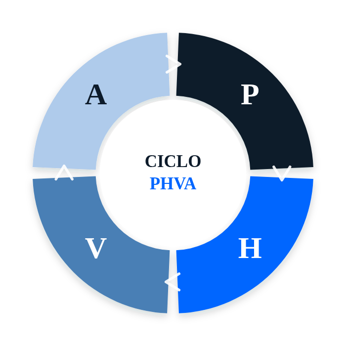

# 24. Gobierno del producto, riesgos y mejora

## 24.1 Gobierno

| **Instancia**                          | **Integrantes**                                  | **Frecuencia**               | **Decide**                                           |
|----------------------------------------|--------------------------------------------------|------------------------------|------------------------------------------------------|
| **Comité de producto**                 | Director General, responsable técnico, Calidad   | Quincenal                    | Prioridad de bloques, aceptación, cambios de alcance |
| **Revisión de arquitectura**           | Responsable técnico, revisor externo             | En cada hito y ante cada ADR | Decisiones técnicas y deuda técnica                  |
| **Revisión de seguridad y privacidad** | Dirección, Oficial de Datos, responsable técnico | Trimestral                   | Accesos, incidentes, riesgos, textos legales         |
| **Revisión por la dirección**          | Dirección y líderes                              | Semestral (PR-SGC-007)       | Desempeño de la plataforma y recursos                |

**Niveles de aprobación de cambios**

| **Tipo de cambio**  | **Ejemplo**                                             | **Aprueba**                                                |
|---------------------|---------------------------------------------------------|------------------------------------------------------------|
| **Menor**           | Texto, ajuste visual, corrección sin impacto en datos   | Responsable técnico                                        |
| **Funcional**       | Nuevo campo, nueva pantalla, cambio de regla de negocio | Líder del proceso y Director General                       |
| **De arquitectura** | Nueva tecnología, cambio de un ADR, nuevo servicio      | Director General con concepto del revisor externo          |
| **Regulado**        | Textos legales, firma, datos personales, impuestos, SST | Director General con validación del profesional competente |
| **De emergencia**   | Corrección urgente de seguridad o de caída              | Responsable técnico; se informa y documenta en 24 horas    |

## 24.2 Riesgos del proyecto

| **Riesgo**                                                                     | **Nivel** | **Control**                                                                                                |
|--------------------------------------------------------------------------------|-----------|------------------------------------------------------------------------------------------------------------|
| **Ampliar el alcance de la primera versión**                                   | Alto      | Numeral 23.8 como línea base; todo lo demás entra a la lista de pendientes                                 |
| **Código generado sin revisión suficiente**                                    | Alto      | Verificaciones automáticas, revisión en sesión separada y cuatro hitos externos                            |
| **Dependencia de una sola persona**                                            | Alto      | Todo documentado en el repositorio; credenciales en el gestor con acceso de emergencia; guías de operación |
| **Fuga o pérdida de datos**                                                    | Crítico   | Capítulo 15, copias ensayadas, prueba de intrusión                                                         |
| **Incumplimiento legal en textos o tratamiento de datos**                      | Alto      | Validaciones del numeral 20.5 antes de publicar                                                            |
| **Reconstruir lo que ya existe (contabilidad, nómina, DIAN)**                  | Alto      | Decisión ADR 016: integrar                                                                                 |
| **Baja adopción por los usuarios**                                             | Medio     | Uso interno desde F3, ayuda enlazada al procedimiento, capacitación                                        |
| **Costo de operación superior al previsto**                                    | Medio     | Un servidor por ambiente; revisión mensual de capacidad                                                    |
| **Cambio o descontinuación de una biblioteca**                                 | Medio     | Bibliotecas maduras; adaptadores para lo externo; actualización semanal                                    |
| **Indisponibilidad del asistente de programación o cambio de sus condiciones** | Medio     | El código es estándar y de la empresa; cualquier desarrollador puede continuarlo                           |

## 24.3 Desarrollo mediante el ciclo PHVA

La siguiente matriz consolida las actividades del documento según la fase del ciclo PHVA a la que pertenecen, con su responsable y el registro que evidencia su ejecución.

| **N.º** | **Fase** | **Actividad**                                                                    | **Responsable**                                | **Registro o documento**                 |
|---------|----------|----------------------------------------------------------------------------------|------------------------------------------------|------------------------------------------|
| 1       | **P**    | Definir la visión, la arquitectura, el marco legal y el plan por bloques         | Director General                               | MN-TEC-002; ADR                          |
| 2       | **P**    | Priorizar y especificar cada bloque con criterios de aceptación                  | Director General y líder de proceso            | docs/bloques                             |
| 3       | **H**    | Construir cada bloque con Claude Code: código, pruebas y documentación           | Claude Code bajo supervisión                   | Pull request; bitácora de cierre         |
| 4       | **H**    | Desplegar en pruebas y en producción con el procedimiento definido               | Responsable técnico                            | Registro de despliegue; notas de versión |
| 5       | **H**    | Cargar la documentación del SGC y configurar formatos y flujos                   | Coordinador de Calidad e Innovación (ISO Lead) | Listado Maestro en línea                 |
| 6       | **V**    | Ejecutar verificaciones automáticas, pruebas de aceptación y revisiones externas | Responsable técnico y revisor                  | Resultados de CI; informes de hito       |
| 7       | **V**    | Medir disponibilidad, seguridad, uso y satisfacción                              | Responsable técnico y Calidad                  | Indicadores del capítulo 25              |
| 8       | **V**    | Revisar accesos, copias, cumplimiento legal y textos publicados                  | Dirección y Oficial de Datos                   | Informes trimestrales; RE-DG-001         |
| 9       | **A**    | Corregir hallazgos, cerrar vulnerabilidades y registrar acciones                 | Responsable técnico                            | FT-SGC-005; RE-SGC-002                   |
| 10      | **A**    | Actualizar el manual y las decisiones de arquitectura                            | Director General                               | FT-SGC-001; nueva versión                |

## 24.4 Mejora continua

Las fallas, sugerencias y hallazgos sobre la plataforma ingresan por la mesa de ayuda y por las auditorías internas, se clasifican y, cuando revelan una causa sistemática, se tratan como acción correctiva con PR-SGC-005. Cada trimestre el comité de producto revisa los indicadores, los incidentes, la deuda técnica y la lista de pendientes, y decide los bloques del periodo siguiente. Las lecciones aprendidas de cada fase se registran y se incorporan a CLAUDE.md o a este manual para que no se repitan.

**Salidas no conformes del producto**

| **Situación**                                                     | **Clasificación** | **Contención y corrección**                                                                                                    |
|-------------------------------------------------------------------|-------------------|--------------------------------------------------------------------------------------------------------------------------------|
| Un usuario accede a información que no le corresponde             | Crítica           | Bloqueo inmediato de la función, análisis de la auditoría, corrección, notificación según PR-TEC-004 y el módulo de privacidad |
| Una versión en producción falla un recorrido crítico              | Mayor             | Reversión a la versión anterior; análisis de causa; prueba automática que reproduzca la falla antes de corregir                |
| Una copia de seguridad no puede restaurarse                       | Mayor             | Nueva copia inmediata, corrección del guion, ensayo adicional                                                                  |
| Un texto legal publicado no corresponde a la versión aprobada     | Mayor             | Retiro y publicación de la versión correcta; revisión de aceptaciones afectadas                                                |
| Un bloque se integró sin cumplir la definición de terminado       | Menor             | Se reabre; no se inicia el bloque siguiente hasta cerrarlo                                                                     |
| Un documento del SGC en la plataforma difiere del Listado Maestro | Menor             | Corrección mediante Solicitud de Acción Documental                                                                             |
